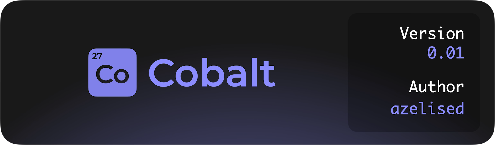

# What is Cobalt?

Cobalt is a hand-built, intuitive UI framework for Luau, made as an beginner-friendly alternative to Fusion.

<p align="center">
  <a href="https://github.com/azelised/cobalt/releases">
    
  </a>
</p>

# Who is this for?

The Cobalt framework is meant for people starting out and existing users of other frameworks who want a simpler syntax.

Cobalt is very easy to change to your needs, with it being only a couple hundred lines long, while maintaining core features of more complex frameworks.

# Using it in your code

Put the file into your codebase's utility folder, require it, and your set!

You can use this code below to generate a simple `TextLabel` to say `"Hello World!"` in Roblox.

```lua
    local cobalt = require("@game/path/to/cobalt")
    local player = game.Players.LocalPlayer

    cobalt:new("ScreenGui", {
        cobalt:new("TextLabel", {
            Text = "Hello World!",
            Size = UDim2.new(1,0,1,0),
        }),
    }):render(player.PlayerGui)
```
