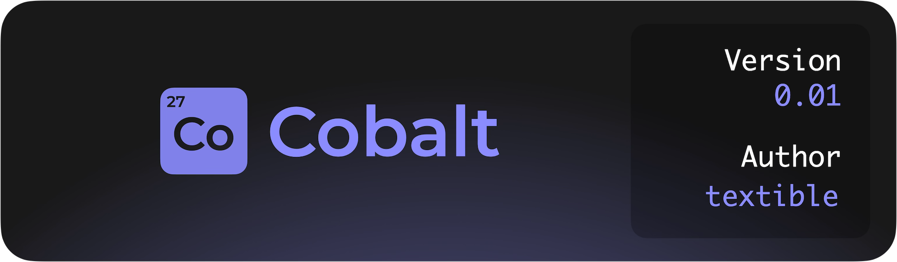

Cobalt is an intuitive UI framework for Luau, made as an simpler alternative to Fusion. 


## Who is this for?

The Cobalt framework is meant for people starting out and existing users of other frameworks who want a simpler syntax.

Cobalt is very easy to change to your needs, with it being only a couple hundred lines long, while maintaining core features of more complex frameworks.

---

## Getting Started

Cobalt can be installed using one of the package managers below.

[Wally](https://just-the-docs.com){: .btn .btn-primary }

You can additonally just get it from roblox directly.

[Roblox](https://just-the-docs.com){: .btn }

---

## Using it in your code

Put the file into your codebase's utility folder, require it, and your set!

You can use this code below to generate a simple `TextLabel` to say `"Hello World!"` in Roblox.

```lua
    local cobalt = require("@game/path/to/cobalt")
    local player = game.Players.LocalPlayer

    cobalt:new("ScreenGui", {           -- Generates a new ScreenGui container
        cobalt:new("TextLabel", {       -- Creates a TextLabel inside of it
            Text = "Hello World!",      -- Sets the text inside the GuiObject
            Size = UDim2.new(1,0,1,0),  -- Makes the GuiObject cover the screen
        }),
    }):render(player.PlayerGui)         -- Renders it inside the player's PlayerGui
```