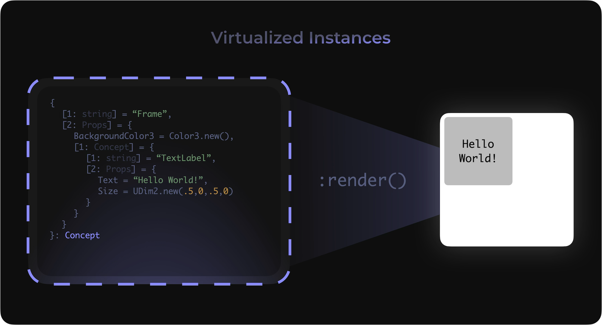

Concepts are the fundamental building blocks of Cobalt. 
They are virtualized instances, that become the final 
product after rendering.

<p align="center">
    
</p>

## :lucide-braces: New

```lua
cobalt:new(class--[[#(1)!]], props?--[[#(2)!]], source?--[[#(3)!]]): Concept
```

1.  `string` The class of the concept.
2.  `props?` Props is short for properties, 
but this field can also contain your concept's connections, children, and class params.
3.  `classSource?` The source of the class, if its a user defined class or a base class.
        
    ???+ Warning
        This parameter is optional, as both class types are checked by default.

##### Description
Creates a new concept, which defines its class, and optionally, 
its properties. You can call this function under cobalt to create 
new one or you can call it underneath an existing concept to parent 
it to it.

##### Usage

TBA

## :lucide-braces: Class

```lua
cobalt:class(class--[[#(1)!]], func--[[#(2)!]]): cobalt
```

1.  `string` The name of the class, can override existing base classes.
2.  `(any)->(Concept)` The function that generates a new concept, this must return a concept.

##### Description
Creates a new class, which can be used to override base classes and 
allows parameters to be passed to it.

##### Usage

TBA

## :lucide-braces: Render

```lua
Concept:render(parent?--[[#(1)!]]): Instance
```

1.  `Instance?` The instance that the concept should be parented to.

    ???+ Warning
        For performance reasons, only assign this parameter
        if you aren't editing the base instances afterwards.

##### Description
Renders the concept into instances. This should be 
called after you are finished editing the concept and
ready to render it onto the screen.

##### Usage

TBA

## :lucide-braces: Props

```lua
Concept:props(props--[[#(1)!]]): Concept
```

1.  `Props` Props is short for properties, 
but this field can also contain your concept's connections, children, and class params.

##### Description
Allows you to assign additional Props to a concept. This can be useful for combining multiple tables.

##### Usage

TBA
