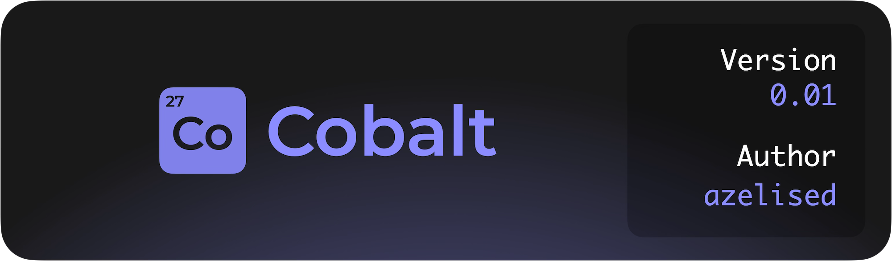

<p align="center">
    
</p>

## What is Cobalt?

Cobalt is an intuitive UI framework for Luau, 
made as an beginner-friendly alternative to Fusion.

## Who is this for?

The Cobalt framework is meant for people starting out 
and existing users of other frameworks who want a simpler syntax.

Cobalt is very easy to change to your needs, 
with it being only a couple hundred lines long, 
while maintaining core features of more complex frameworks.

## Installation

???+ warning "Disclaimer"

    Cobalt is pre-1.0, meaning things are subject to change vastly, 
    and might require you to change your code significantly if you decide to 
    upgrade to the latest version.


Cobalt can be installed using one of the package managers below.

[Wally :lucide-package:](https://github.com/azelised/cobalt/releases){ .md-button .md-button--primary }
[Github :fontawesome-brands-github:](https://github.com/azelised/cobalt/releases){ .md-button }

## Using it in your code

Put the file into your codebase's utility folder, require it, and your set!

You can use this code below to generate a simple `TextLabel` to say `"Hello World!"` in Roblox.

``` lua

    local cobalt = require("@game/path/to/cobalt")
    local player = game.Players.LocalPlayer

    cobalt:new("ScreenGui", {
        cobalt:new("TextLabel", {
            Text = "Hello World!",
            Size = UDim2.new(1,0,1,0),
        }),
    }):render(player.PlayerGui)

```